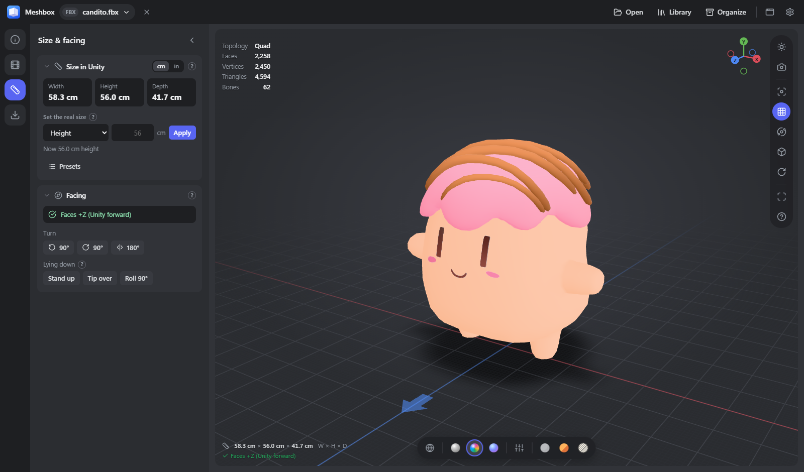

# Meshbox

A fast Windows viewer and organizer for 3D models - FBX first, plus Blender `.blend`, GLB/glTF/VRM, OBJ,
STL, PLY, DAE, 3DS, 3MF and USDZ. A .NET 8 + WebView2 app (dark Discord-like UI) with a
three.js viewport, made for getting models into Unity at the right size, facing the right way.



## Install

Build it (below), then run **`dist\MeshboxSetup.exe`** (one file, about 10 MB, no admin rights needed).
The setup window shows where Meshbox goes and its progress: it installs Meshbox for your Windows account
in `%LOCALAPPDATA%\Programs\Meshbox`, adds it to the Start menu and to "Open with" for 3D files, and to
Settings > Apps for uninstalling. Running it again updates Meshbox (closing it first if it is open) and
keeps your settings, thumbnails and library. `MeshboxSetup.exe /quiet [/desktop]` installs without any
window, `/demo` walks through the screens without installing anything.

```powershell
.\build.ps1      # UI bundle, the app in .\dist\Meshbox and the installer .\dist\MeshboxSetup.exe
.\install.ps1    # (while developing) installs .\dist\Meshbox directly, same result as the setup
```

Building needs Node.js 18+ and the .NET 8 SDK.

Needs the .NET 8 Desktop Runtime and the Edge WebView2 runtime
(part of Windows 11). `.blend` previews and FBX export use the newest Blender found (Steam, Program Files,
or the path set in Settings). Uninstall from Settings → Apps.

To make it the default app for `.fbx`: right-click an FBX → Open with → Choose another app →
Meshbox → Always.

## Viewer

- **Open**: double-click in Explorer, drag & drop, `Ctrl+O`, recent files (in the file menu at the top;
  the start screen stays clean). Each file opens in its own
  window (Settings to change); `Ctrl+N` opens an empty window to compare models side by side.
  **Close** the model with the `×` next to its name (or `Ctrl+W`) to get back to the start screen.
- **Environment** (sun icon): Studio, Beach, Desert, Forest, Interior, Night HDRIs (Poly Haven, CC0),
  strength, rotation, auto rotate, background (studio gradient, dark, HDRI, color), ground shadow.
- **Views** (bottom bar): wireframe (quads for FBX, no triangle diagonals), solid, textured, normals,
  view settings (flat/smooth, topology, gizmo, grid, tone mapping, exposure, **bloom** with strength,
  radius and threshold), unlit, anime, sketch (pencil or manga ink).
- **Sliders** show their default as a mark on the track; double-click a slider (or its reset button)
  to go back to it. **Ctrl+Z / Ctrl+Y** undo and redo any look change (sliders, environment, views,
  toggles); a whole slider drag is one step.
- **Camera**: reset (`F`), grid (`G`), orbit / free fly (`N`, then WASD + Q/E; back in orbit it
  rotates around the same point as before flying, the model's centre unless you double-clicked
  elsewhere), perspective / ortho
  (`O`, numpad `5`), Blender-style numpad views `1 3 7`, turntable (`T`), full screen (`F11`), the XYZ
  gizmo is clickable.
- **Materials** from FBX, OBJ, Collada and 3DS are read the way Blender and Unity read them: transparency
  comes from what the texture really holds (cut-outs like eyes, lashes and decals stay solid with clean
  edges, see-through glass stays see-through, an alpha link on an opaque image is ignored), roughness
  comes from FBX shininess with Unity's formula, and emission textures glow when their strength is
  above 0.
- **Topology** (top left): Faces, Vertices (true polygon counts for FBX and .blend), triangles, bones.
- **Animations**: clip list, play/pause, scrub, speed, loop, rest pose. *Load animations or poses…*
  adds clips from other files: same bone names play directly (Unity-style `Model@Clip.fbx` files next
  to the model are detected), different humanoid rigs (Mixamo, Rigify, Auto-Rig Pro, VRoid, Advanced
  Skeleton) are retargeted. Drop animation files on the window with `Shift`.
- **Screenshots** (`P`, camera icon): PNG at 1×, 2× or 4×, transparent, almost-black or as shown;
  `Ctrl+C` copies to the clipboard.
- **Model info** (`I`): format, who saved it (Blender version), the **Unity check** (root scale 1,1,1,
  no root rotation, faces +Z, pivot at the bottom), geometry, rig/humanoid, and every texture:
  embedded/packed, linked, found elsewhere, **missing**, or borrowed from another model's folder.

## Size & facing (`S`) and Export (`E`)

Two pages in the left rail, built like Blender's Properties editor: collapsible groups (they remember
being open or closed) and the explanations behind small `?` icons.

- **Size in Unity**, measured as Unity imports it, in **centimeters or inches** (the `cm | in` switch
  on the group, or Settings; it applies everywhere, including the size line under the model). Type a
  target height/width/depth to standardize; presets for typical character sizes.
- **Facing**: humanoids are checked automatically (+Z is Unity forward) with a one-click fix; any model
  can be turned 90°/180° or stood up (Z-up mix-ups). The blue arrow on the floor points to +Z.
- Fixes are previewed live, remembered per model, used for thumbnails, and **baked by Blender** when you
  export: **Export FBX for Unity** writes `Model.fbx` + `Textures\` with relative paths, scale 1,1,1 and
  an optional `.materials.json` PBR manifest. **Send to Unity** copies it into a project from Unity Hub
  (optionally with `Assets/Editor/MeshboxModelImporter.cs`, which sets the import settings, a Humanoid
  avatar and URP/Standard materials from the manifest).
- **Quick export (no Blender)**: GLB of what you see.

## Library

Point it at your folders (Settings → Library, or drop a folder on the window). It finds every model,
groups versions into families (`dog1`, `dog2`, `dog3final`, `dog4_rigged` → one *dog* card), shows a
thumbnail of each - all rendered the same way, from the front (+Z) - and badges for rig, clips, missing
textures and wrong facing. Filters: FBX only, Blender only, rigged, animated, needs work.

You browse it like Explorer: folder cards (with a preview of what is inside and how many models) open
into their subfolders and models, with a breadcrumb at the top (`Backspace` goes up). Search looks inside
the open folder. **Collections** (sidebar) are your own groups: right-click a model > Add to collection.

Hover a card for the **Organize** button and the `...` menu (same as right-click): open, open in new
window/Blender, show in Explorer, **update thumbnail**, **use current view as thumbnail**, star,
versions, organize, move to Recycle Bin.

**Organize...** (library toolbar) organizes many models in one go: every model in the current view
(folder, filters and search apply), or *Organize all* on the Cleanup page for the models with many
versions. You first review a table with each model's destination (Project / Category / Asset, all
editable, "Set project..." for the ticked ones); FBX/VRM files sitting next to a .blend model start
unticked as likely exports, and two models that would land in the same folder are renamed after their
own folder (`Mini Hero`) or left unticked. Models then run one after another with a progress list;
models already in the library are skipped (or get new versions), failed ones can be retried, and at the
end one confirmed *Recycle originals* covers every organized model.

**Cleanup** finds Blender auto-backups (`.blend1`), models with many versions, and exact duplicates.
Everything goes to the Recycle Bin, after a confirmation that lists the files.

## The workflow it is built for

One folder per model, anywhere you like (pick a drive with space):

```
E:\3D Library\MyGame\Characters\Hero\
    Hero.blend      ← the one working file
    Hero.fbx        ← Unity-ready export (scale 1,1,1, faces +Z)
    Textures\          ← every texture both files use, linked with relative paths:
                         T_Hero_Body_BaseColor.png, T_Hero_Body_Normal.png, T_Hero_Eyes_BaseColor.png…
    Versions\          ← Hero_v001_2025-06-09_….blend …, open directly in Blender (NTFS-compressed:
                         saves space on uncompressed .blend files; ones saved with Blender's own
                         "Compress" option are already small)
    asset.json         ← where each version came from (+ SHA-256)
```

1. **Organize** a model: the **Organize** button in the top bar (for the open model) or on a library
   card, or many at once with **Organize...** in the library toolbar. Pick the main `.blend` and the old versions to keep; it copies them into the layout above,
   gathers the textures it can find into `Textures\` with standard names (relinking the .blend), exports
   the Unity FBX and compresses the old versions. A model with no .blend (FBX, glTF, OBJ) is imported
   into Blender, so you get the same `.blend` + FBX + `Textures\` set. Your original files stay where they
   were until you choose *Recycle originals*.
2. From then on **work on `Hero.blend` only**. When you reach a milestone (rigged, weights fixed,
   baked…), use **File → Save Milestone…** in Blender (Settings → Install add-on): it saves, then drops a
   dated, compressed copy with your note in `Versions\`. No more `Hero55.blend`, `Hero56Applied…`,
   and every old state is still one click away in the library's versions list.
3. Export / Send to Unity whenever the FBX should be refreshed. Because everything lives in one folder
   with relative paths, you can move or rename the whole folder (or library) without breaking a link.

## Texture names

Organize and *Export FBX for Unity* name textures the way most Unity and Unreal teams do:

```
T_<Asset>_<Part>_<Map>.png      T_Hero_Body_BaseColor.png   T_Hero_Body_Normal.png
                                T_Hero_Body_Roughness.png   T_Hero_Eyes_BaseColor.png
```

- `T_` marks a texture (materials would be `M_`), `<Asset>` keeps names unique across a Unity project,
  `<Map>` is always the last word.
- `<Map>` comes from how the image is wired in the material: **BaseColor** (diffuse/albedo),
  **Normal**, **Roughness**, **Metallic**, **AO**, **Emission**, **Opacity**, **Height**, **Mask**,
  packed maps like **ORM**; toon setups get **Shadow** (shade color), **Matcap**, **Ramp**...
- `<Part>` comes from the old file name (`Tex_Eyes.png`, `T_eyes.png`, `Eyes.png` → `Eyes`), or the
  material when the file name says nothing (`texture_0.png`).
- The `.blend`, the FBX and the `.materials.json` all point at the new names, and `asset.json` lists
  where every texture came from. Unity's importer helper marks `_Normal` as a normal map and data maps
  (`_Roughness`, `_Metallic`, `_AO`, `_Mask`...) as linear.
- Choose *Keep original* (Export panel) or untick *Standard texture names* (Organize) to keep the old
  names.

## Project layout

```
src/Host     .NET 8 WPF + WebView2 host: window, file server with texture search, .blend thumbnails,
             Blender runner, library/Unity helpers, Explorer integration
src/web      UI (three.js r187 bundled by esbuild): viewer, panels, library
src/blender  Blender scripts: preview.py, export_fbx.py, organize.py, meshbox_milestones.py (add-on)
src/unity    MeshboxModelImporter.cs (optional Unity editor script)
src/Setup    MeshboxSetup.exe: one-file per-user installer with its own WPF window (build.ps1 embeds
             dist\Meshbox in it)
tools        build-web.mjs, patch-fbxloader.mjs (adds quad/polygon info to three's FBXLoader)
```

Development: `node tools/build-web.mjs --dev`, `dotnet build src/Host`, run the exe with
`MESHBOX_DEV=1` to enable DevTools (F12).

App icon: edit `src/Host/icon/meshbox.svg` (40 px and up) and `meshbox-small.svg` (16-32 px), then
`node --experimental-websocket tools/make-icon.mjs [preview.png]` renders them with headless Edge into
`src/Host/app.ico`.
